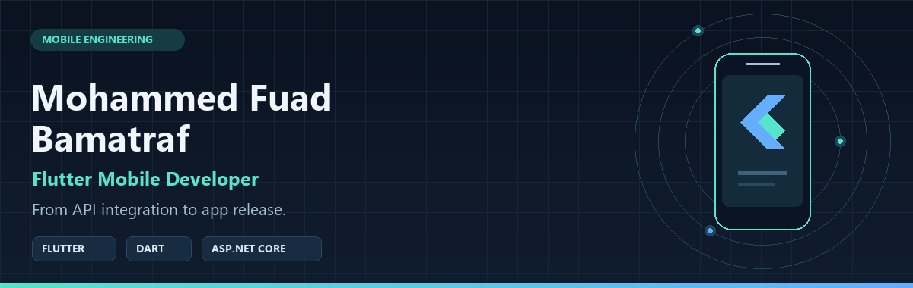
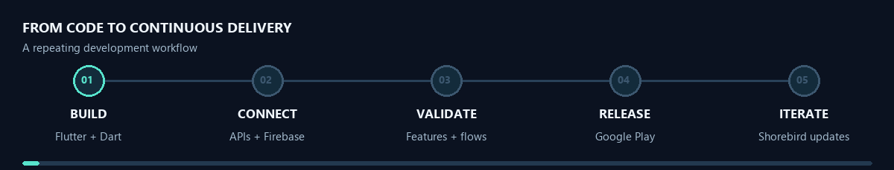
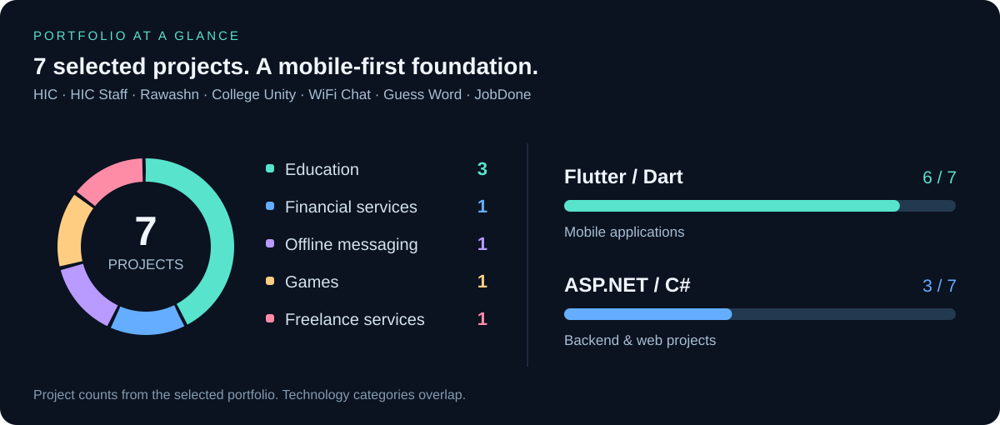
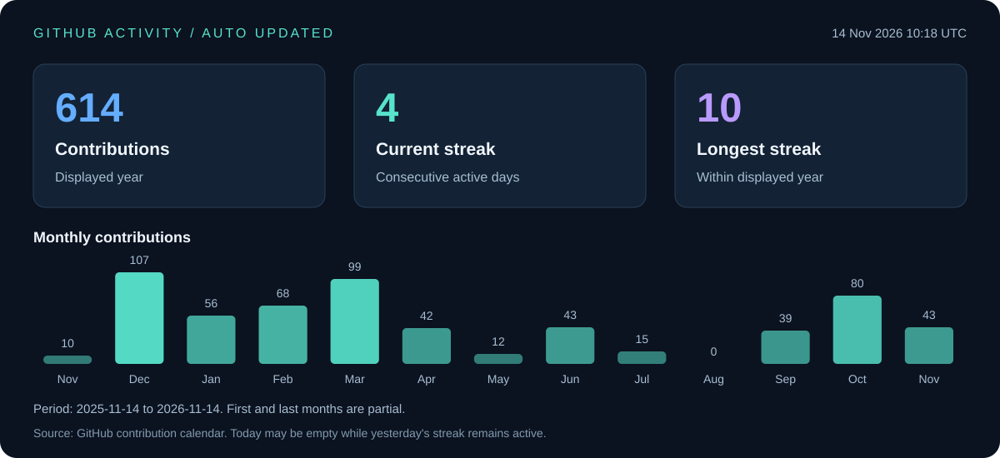

  

<a href="#featured-apps">📱 Featured apps</a> &nbsp; · &nbsp; <a href="#toolkit">🧰 Tech stack</a> &nbsp; · &nbsp; <a href="#activity">📊 Activity</a> &nbsp; · &nbsp; <a href="#contact">🤝 Contact</a>

## 👋 About me

I'm **Mohammed**, a Flutter developer based in Hadramout, Yemen. I build and maintain mobile applications for **education and financial services**, with hands-on ownership of features, API integration, Android releases, and ongoing updates.

My backend experience with **C#, ASP.NET Core, and SQL Server** helps me connect the mobile experience to the systems behind it. I care about maintainable architecture, dependable state and session handling, and Arabic/English interfaces that feel natural to use.

- **Currently:** Full-Stack Developer at **Business World Company LTD.**, with a focus on Flutter mobile development.
- **Recent apps:** HIC, HIC Staff, and Rawashn.
- **Delivery:** Google Play Console release workflows and Shorebird code updates.

## 📱 Featured apps

### 🎒 HIC — Student App

**Student services for Hadhramout International Community College.**

Develop and maintain the Flutter app for student information, curriculum, lecture schedules, study fees, and college notifications. Integrate college APIs, Arabic/English localization, Firebase push notifications, and Shorebird updates.

*Flutter · Riverpod · Dio · Retrofit · Firebase · Shorebird*  
[View on Google Play →](https://play.google.com/store/apps/details?id=ye.edu.hic.app)

### 🧑‍🏫 HIC Staff

**Mobile tools for the college's teaching staff.**

Develop assigned-course and lecture-schedule features, student attendance, and lecture creation based on user permissions. Implement bilingual interfaces, API integration, and notifications, and prepare Android builds and Google Play review submissions.

*Flutter · Riverpod · Dio · Retrofit · Firebase · Shorebird*  
[View on Google Play →](https://play.google.com/store/apps/details?id=ye.edu.hic.staff_app)

### 💳 Rawashn

**A financial platform for household purchases before salary payment.**

Own mobile development, maintenance, and updates. Implement wallet transactions and settlements, NFC and QR payment flows, role-based access, and session/token handling; contribute to backend implementation and database design.

*Flutter · Dart · ASP.NET Core Web API · SQL Server*  
[Visit Rawashn →](https://rawashn.com/)

## 💼 Experience

**Full-Stack Developer · Business World Company LTD.**  
*Dec 2025 – Present*

- Build and maintain Flutter apps with REST APIs, Firebase notifications, and real-time services.
- Collaborate on ASP.NET Core services and database design using structured architecture and SOLID principles.
- Handle Android release workflows through Google Play Console and Flutter updates with Shorebird.

**ASP.NET Backend Developer · Arab Ware Dos Company**  
*Oct 2025*

- Developed ASP.NET Core Web APIs using C#, Entity Framework, and SQL Server.
- Collaborated with frontend and mobile teams on API integration, sprint planning, and code reviews.
- Applied Clean Architecture and SOLID principles.

## 🔄 From code to release

## 🧰 Technical toolkit

### 📱 Mobile & state management

### ⚙️ Backend & real time

### 🗄️ Data & cloud

### 🚀 Delivery & collaboration

<strong>🔎 Architecture, integrations & engineering practices</strong>

| Area | Technologies & practices |
| :--- | :--- |
| **Mobile** | Flutter, Dart, responsive UI, Arabic/English localization |
| **State & architecture** | Riverpod, BLoC/Cubit, Provider, Clean Architecture, SOLID, dependency injection |
| **APIs & real time** | REST, Dio, Retrofit, Freezed, JSON serialization, SignalR, Firebase Cloud Messaging |
| **Data & device features** | Drift, SQLite, Hive, secure storage, JWT, NFC, QR, biometric authentication |
| **Backend** | C#, ASP.NET Core Web API, Entity Framework, SQL Server |
| **Delivery & teamwork** | Git, GitHub, GitHub Actions, Flutter flavors, Google Play Console, Shorebird, Agile/Scrum |

## 🧭 Portfolio map

## 🛠️ Selected open-source work

| Project | What I built |
| :--- | :--- |
| [**WiFi Chat**](https://github.com/moodyfuad/wifi_chat_app) | Flutter messaging over a shared local Wi-Fi network, without internet access. Provider, SQLite, and Hive. |
| [**College Unity**](https://github.com/moodyfuad/CollegeUnity_BackEnd) | A university communication platform with chat, announcements, learning materials, and schedules. Full-stack developer & Scrum Master; Flutter, ASP.NET Core, JWT, and React. |
| [**Guess Word**](https://github.com/moodyfuad/word_guess_flutter) | An Arabic word game with single-player scores and online multiplayer. Flutter, GetX, and SignalR. |
| [**JobDone**](https://github.com/moodyfuad/JobDone) | A freelance services web application. Full-stack developer & Product Manager; ASP.NET MVC, C#, and SQL Server. **Best third-year project, 2024.** |

## 🎓 Education & recognition

**Bachelor of Information Technology · Hadhramout University**  
2025 · **Graduated with Honors** · **GPA: 93.04 / 100**

**Best third-year project — JobDone, 2024**

## 📊 GitHub activity

Updated daily by [GitHub Actions](https://github.com/moodyfuad/moodyfuad/actions/workflows/update-profile.yml) from GitHub's contribution calendar. The card shows its latest successful update time. Streaks cover the displayed year; today may be empty while yesterday's streak remains active.

---

## 🤝 Let's connect

<strong>Let's build a mobile experience people can rely on.</strong>

📞 <strong>+967 739 778 333</strong> &nbsp; · &nbsp; 💬 <a href="https://wa.me/967739778333">Chat on WhatsApp</a> ✉️ <a href="mailto:moho.foho@gmail.com">moho.foho@gmail.com</a>

